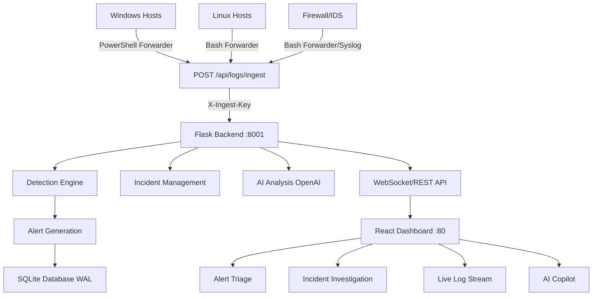

# 🛡️ AI SOC Dashboard

> A production-oriented Security Operations Center platform for centralized log ingestion, deterministic threat detection, real-time alert management, incident response, and optional AI-assisted security analysis.


---

## Overview

An AI-assisted Security Operations Center (SOC) platform designed for security log ingestion, detection, alert management, incident response, MITRE ATT&CK mapping, AI-assisted triage, and SOC monitoring with Windows/Linux/firewall log forwarding.

**Important:** AI assistance does NOT replace deterministic detection. AI output provides assessment and context but should be treated as analyst support rather than confirmed fact. The core detection engine uses rule-based logic and sliding-window thresholds.

---

## Key Features

### Security Monitoring
- **Multi-source ingestion** — Windows Event Logs (XML/text), Linux syslog/journald, firewall logs, JSON, CSV, plain text
- **Real-time log streaming** — Live WebSocket feed with per-severity filtering
- **File upload & analysis** — Drag-and-drop log file parsing and rule evaluation
- **Source identification** — Automatic tagging by source type (Windows/Linux/firewall)

### Detection & Alerting
- **13 detection rules** — Brute force, privilege escalation, suspicious PowerShell, malware, lateral movement, unusual login time, service installation, firewall anomalies, DNS tunneling, account lockout, password spraying, scheduled task creation
- **Sliding-window thresholds** — Rules require multiple events within time window to avoid single-event noise
- **Evidence capture** — Related logs, source IPs, usernames, timestamps automatically linked to alerts
- **Deduplication** — Prevents duplicate alerts for identical events

### Incident Response
- **Incident grouping** — Combine related alerts into trackable cases
- **Status tracking** — NEW → TRIAGED → INVESTIGATING → CONTAINED → RESOLVED workflow
- **Analyst assignment** — Assign incidents to team members
- **Timeline & notes** — Track investigation steps and resolution
- **False positive classification** — Mark alerts as TRUE_POSITIVE, FALSE_POSITIVE, or BENIGN
- **Audit trail** — All analyst actions logged for compliance

### AI-Assisted Analysis
- **Optional AI integration** — OpenAI support with graceful demo mode fallback when no key is configured
- **Alert assessment** — Context, severity justification, recommended actions
- **Threat scoring** — Risk assessment across all current alerts
- **AI Copilot chat** — Natural language questions about logs and incidents
- **Incident reports** — Auto-generated markdown incident reports

### MITRE ATT&CK
- **Automatic technique mapping** — Every alert mapped to relevant MITRE ATT&CK techniques
- **Technique coverage** — T1110 (Brute Force), T1078 (Valid Accounts), T1059.001 (PowerShell), T1027 (Obfuscation), T1048 (Exfiltration), T1021/T1570 (Lateral Movement), T1543.003 (Service Install), T1562.004 (Firewall Disable), T1071.004 (DNS Tunneling), T1053.005 (Scheduled Task)
- **Kill chain phase** — Displays attack progression stage

### Log Ingestion
- **Windows forwarder** — Native PowerShell script, no agent required
- **Linux forwarder** — Bash script supporting journald and log files
- **Firewall forwarder** — Bash script for local logs or remote syslog (UFW, iptables, pfSense, Cisco ASA, Palo Alto)
- **API-based authentication** — X-Ingest-Key header for secure forwarder→backend communication
- **Rate limiting** — Per-source IP throttling to prevent abuse

### Real-Time Updates
- **WebSocket/Socket.IO** — Live log stream and alert notifications
- **Live ingestion page** — Real-time feed of incoming logs with severity filtering
- **Dashboard updates** — KPIs refresh automatically

### Authentication & Authorization
- **Session-based auth** — Secure token management with 24-hour expiry
- **Password hashing** — Werkzeug salted bcrypt-equivalent hashing
- **Role-based access control** — Admin, Senior Analyst, Analyst, Readonly roles
- **Ingest key management** — Separate API keys for log forwarders

### SOC Dashboard
- **KPI metrics** — Total events, alerts by severity, open incidents, mean time to resolution, false positive rate
- **Top attackers** — Most active source IPs
- **Threat timeline** — Alerts and events over time
- **Detection categories** — Alert distribution by MITRE technique
- **Dark mode UI** — Designed for analysts working in low-light environments

---

## Architecture



---

## Technology Stack

### Backend

| Component | Technology | Version |
|-----------|-----------|---------|
| Framework | Flask | 3.1.3 |
| Real-time | Flask-SocketIO | 5.6.1 |
| CORS | Flask-CORS | 6.0.0 |
| Database | SQLite (WAL mode) | Built-in |
| Config | python-dotenv | 1.2.2 |
| Server | Gunicorn | 23.0.0 |
| AI (optional) | OpenAI SDK | 1.30.0+ |
| Tests | pytest | 9.x |
| Security | Bandit, pip-audit | Latest |

**Database:** SQLite with WAL (Write-Ahead Logging) journal mode is used for all data storage. No external database required.

**Important:** PostgreSQL support is **not currently enabled**. The application explicitly blocks non-SQLite DATABASE_URL values. PostgreSQL adapter implementation requires schema migration and SQL dialect changes.

### Frontend

| Component | Technology | Version |
|-----------|-----------|---------|
| Framework | React | 18.2.0 |
| Language | TypeScript | 5.3 |
| Build | Vite | 8.2.2 |
| Styling | Tailwind CSS | 3.4 |
| Charts | Recharts | 2.10.3 |
| State | Zustand | 4.4.7 |
| Real-time | Socket.IO client | 4.7.2 |
| HTTP | Axios | 1.6.2 |
| Router | React Router DOM | 7.18.2 |
| Icons | Lucide React | 0.294.0 |

### Deployment

- **Containers** — Dockerfile for backend and frontend
- **Orchestration** — Docker Compose for local and development deployments
- **Reverse Proxy** — Nginx (frontend container), Caddy config example provided
- **CI/CD** — GitHub Actions workflow (tests, security scans, Docker builds)

---

## Quick Start

### Option 1: Docker (Recommended)

Fastest way to get running:

```bash
# Clone repository
git clone <repository-url>
cd ai-soc-dashboard

# Create backend/.env from template
cp backend/.env.example backend/.env

# Edit backend/.env (optional for demo):
# - Set OPENAI_API_KEY if you want live AI (optional)
# - Generate INGEST_KEY via dashboard after first login

# Build and start
docker compose up --build -d

# Check status
docker compose ps

# View logs
docker compose logs -f
```

Then open:
- **Dashboard:** http://localhost (Nginx serves frontend)
- **Backend API:** http://localhost:8001/api/health (should return `{"status":"healthy"}`)

Create your first admin account on the login screen.

### Option 2: Local Development

**Prerequisites:**
- Python 3.12+
- Node.js 20+
- npm

**Backend** (in terminal 1):

```powershell
cd backend

# Create virtual environment
python -m venv .venv

# Activate (Windows PowerShell)
.venv\Scripts\Activate.ps1

# Activate (Linux/macOS)
source .venv/bin/activate

# Install dependencies
pip install -r requirements.txt

# Copy environment template
cp .env.example .env

# Run backend
python run.py
```

Backend runs at http://localhost:8001

**Frontend** (in terminal 2):

```bash
cd frontend

# Install dependencies
npm install

# Run development server
npm run dev
```

Frontend runs at http://localhost:5173 with automatic proxy to backend.

---

## Environment Configuration

### Getting Started

```bash
# Copy environment templates
cp backend/.env.example backend/.env

# Minimum configuration for local demo (all optional):
# backend/.env:
# APP_ENV=development
# SECRET_KEY=<will use default if not set>
# OPENAI_API_KEY=<empty = demo mode>
```

### Complete Environment Variables

| Variable | Default | Required | Description |
|----------|---------|----------|-------------|
| `APP_ENV` | `development` | No | Set to `production` to enforce strict security checks |
| `SECRET_KEY` | *(default insecure)* | Yes (prod) | Session signing key; at least 32 characters |
| `OPENAI_API_KEY` | *(empty)* | No | OpenAI API key; empty = demo mode with mock responses |
| `OPENAI_MODEL` | `gpt-4o-mini` | No | Model name (gpt-4o, gpt-3.5-turbo, etc.) |
| `FLASK_DEBUG` | `false` | No | Enable auto-reload in development |
| `FLASK_HOST` | `0.0.0.0` | No | Bind address |
| `PORT` | `8001` | No | Backend listen port |
| `CORS_ORIGINS` | `localhost` (dev) | Yes (prod) | Comma-separated allowed origins |
| `DEMO_MODE` | `false` | No | Create demo users (development only) |
| `ADMIN_EMAIL` | *(empty)* | No | Bootstrap admin email (used once when users table empty) |
| `ADMIN_PASSWORD` | *(empty)* | No | Bootstrap admin password (min 12 characters, used once) |
| `INGEST_KEY` | *(empty)* | No | Single convenience ingest key (DB keys take precedence) |
| `DATABASE_PATH` | `backend/soc_dashboard.db` | No | SQLite database file location |
| `UPLOAD_DIR` | `backend/uploads/` | No | Directory for uploaded files |
| `MAX_UPLOAD_SIZE` | `52428800` (50 MB) | No | Maximum file upload size in bytes |
| `MAX_INGEST_PAYLOAD_SIZE` | `2097152` (2 MB) | No | Max /api/logs/ingest payload size |

**Production mode (`APP_ENV=production`) enforces:**
- `SECRET_KEY` must be at least 32 characters and not the default
- `CORS_ORIGINS` must be explicit HTTPS origins (no HTTP, no `*`)
- Startup fails immediately if these checks fail

**Development mode (`APP_ENV=development`) warnings:**
- Weak secrets allowed but warned
- CORS defaults to localhost
- Demo accounts never created unless `DEMO_MODE=true`

---

## Authentication & Ingest Keys

### User Authentication

- **Login endpoint:** `/api/auth/login` (POST `{"email": "...", "password": "..."}`)
- **Protected endpoints:** Require `Authorization: Bearer <token>` header
- **Session duration:** 24 hours
- **Roles:** Admin (full access), Senior Analyst (manage alerts/incidents), Analyst (view/triage), Readonly (view only)

### Ingest Keys

Ingest keys allow external systems (Windows, Linux, firewall) to securely send logs without user passwords.

**Generate a key:**

1. Log in to dashboard
2. Navigate to **Settings → Ingest Keys**
3. Click **Generate** and provide name (e.g., `windows-forwarder-01`)
4. **Copy the key immediately** — shown only once
5. Use in forwarder: `INGEST_KEY=soc-...`

**Key features:**
- Cryptographically random, long keys
- Revocable from Settings page
- Rate-limited per source IP
- All usage audited

**Security note:** If an ingest key is exposed or committed to version control, **revoke it immediately** and generate a new one.

---

## Log Forwarders

### Windows Log Forwarder

Collects Windows Event Log entries and sends to SOC dashboard.

**Features:**
- Runs as Administrator (required for Security log access)
- Collects meaningful Windows events every 5 seconds
- Filters Security log to avoid credential read spam
- Supports local or remote SOC dashboard

**Setup:**

```powershell
# Option A: Using launcher (easiest)
# 1. Create .env file in project root with:
#    INGEST_KEY=soc-<your-key-from-dashboard>
#
# 2. Double-click START-SOC-FORWARDER.bat
#    OR from PowerShell:
.\START-SOC-FORWARDER.bat

# Option B: Direct PowerShell (run as Administrator)
$env:INGEST_KEY = "soc-<your-key>"
.\windows-log-forwarder.ps1 -ApiUrl "http://localhost:8001/api/logs/ingest"

# Option C: Remote SOC dashboard
$env:INGEST_KEY = "soc-<your-key>"
.\windows-log-forwarder.ps1 -ApiUrl "http://<SOC-SERVER-IP>:8001/api/logs/ingest"
```

**Expected behavior:**
- **With Administrator:** Collects Security, System, Application, PowerShell, TaskScheduler, Windows Defender logs
- **Without Administrator:** Skips Security log, collects other logs with warning

### Linux Log Forwarder

Monitors Linux system logs and sends to SOC dashboard.

**Features:**
- Monitors `/var/log/auth.log`, `/var/log/syslog`, `/var/log/kern.log`, `/var/log/ufw.log`, and others
- Falls back to `journalctl` if log files unavailable
- Sends logs every 5 seconds
- Requires root access to read log files

**Setup:**

```bash
# Local dashboard
sudo ./linux-log-forwarder.sh

# Remote dashboard (specify SOC server IP)
SOC_URL="http://192.168.1.50:8001/api/logs/ingest" \
INGEST_KEY="soc-<your-key>" \
sudo ./linux-log-forwarder.sh

# Or export variables
export SOC_URL="http://<soc-ip>:8001/api/logs/ingest"
export INGEST_KEY="soc-<your-key>"
sudo -E ./linux-log-forwarder.sh
```

**Networking from VM to Host:**

⚠️ `localhost` inside Linux VM = Linux VM, NOT Windows host!

```bash
# Find Windows host IP from inside Linux VM:
# VirtualBox NAT: typically 10.0.2.2
curl http://10.0.2.2:8001/api/health

# Bridged network: use actual host IP
ip route | grep default

# Test connectivity
curl http://<verified-ip>:8001/api/health
# Should return: {"status":"healthy"}
```

### Firewall Log Forwarder

Collects firewall logs from local firewalls or remote network firewalls via syslog.

**Local firewall logs (on-box):**

```bash
# Monitors UFW, iptables, pf logs
SOC_URL="http://<soc-ip>:8001/api/logs/ingest" \
INGEST_KEY="soc-<your-key>" \
sudo ./firewall-log-forwarder.sh
```

**Network firewall syslog (centralized):**

```bash
# Start syslog listener on UDP port 514
SOC_URL="http://<soc-ip>:8001/api/logs/ingest" \
INGEST_KEY="soc-<your-key>" \
sudo ./firewall-log-forwarder.sh --syslog
```

Then configure your firewall to send syslog:
- **pfSense/OPNsense:** System → Settings → Logging → Remote syslog: `<soc-ip>:514`
- **Cisco ASA:** `logging host <soc-ip>`
- **Palo Alto:** Device → Log Settings → Syslog → Server: `<soc-ip>:514`

---

## Test Ingestion

Verify backend connectivity and authentication:

```bash
# Health check
curl http://localhost:8001/api/health

# Manual log ingestion test
curl -X POST "http://localhost:8001/api/logs/ingest" \
  -H "Content-Type: application/json" \
  -H "X-Ingest-Key: soc-<your-key>" \
  -d '{
    "logs": [{
      "timestamp": "2026-09-01T12:00:00Z",
      "source": "test-machine",
      "source_type": "windows",
      "event_type": "security",
      "severity": "high",
      "message": "Failed password for administrator from 192.168.1.50",
      "source_ip": "192.168.1.50",
      "username": "administrator"
    }]
  }'

# Expected response:
# {"status":"success","ingested":1,"alerts_generated":1}
```

---

## Dashboard Pages

- **Dashboard** — Overview with KPIs, recent alerts, top source IPs, threat timeline
- **Alerts** — Full-text searchable alert list, triage by severity/status/rule
- **Log Explorer** — Search all ingested logs by source, IP, username, keyword, time range
- **Live Ingestion** — Real-time WebSocket feed of incoming logs with severity filtering
- **Incidents** — Group related alerts, track status, notes, analyst assignment, resolution
- **AI Copilot** — Chat with AI about logs, trends, and security questions (requires OpenAI key)
- **File Upload** — Drag-and-drop log file parsing and analysis
- **Settings** — Ingest key management, detection rule configuration, AI status

---

## Detection Engine

The detection engine is **deterministic** (not AI-based) and uses sliding-window thresholds.

### Built-in Rules

| Rule | Severity | Threshold | MITRE |
|------|----------|-----------|-------|
| Brute Force Login | HIGH | 3 failures / 5 min | T1110 |
| Password Spraying | HIGH | 3 failures / 5 min across 2+ accounts | T1110.003 |
| Privilege Escalation | CRITICAL | Event IDs 4728, 4732, 4756, 4720 | T1078, T1068 |
| Suspicious PowerShell | CRITICAL | Encoded commands, download cradles | T1059.001, T1027 |
| Data Exfiltration | CRITICAL | Large outbound transfer keywords | T1048 |
| Lateral Movement | HIGH | RDP type-10 logon, external network logon | T1021, T1570 |
| Malware Detected | CRITICAL | AV/EDR threat signatures | T1204, T1059 |
| Unusual Login Time | MEDIUM | Successful logon 23:00–06:00 | T1078 |
| Service Installation | HIGH | New Windows service (event ID 7045) | T1543.003 |
| Firewall Anomaly | MEDIUM | Firewall rule changes | T1562.004 |
| DNS Tunneling | HIGH | Large DNS payloads with high entropy | T1071.004 |
| Account Lockout | HIGH | Event ID 4740 | T1110.003 |
| Scheduled Task Created | HIGH | New scheduled task (event ID 4698) | T1053.005 |

**Sliding-window logic:** Rules require multiple events within a time window. For example, "Brute Force Login" requires 3 failed login attempts within 5 minutes from the same source IP. Single events do not generate alerts.

**Analyst actions:**
- **Classify** — TRUE_POSITIVE, FALSE_POSITIVE, BENIGN
- **Escalate** — Create incident from alert
- **Investigate** — View related logs, correlations, AI assessment
- **Resolve** — Close with reason

---

## API Reference

### Authentication

| Method | Path | Auth | Description |
|--------|------|------|-------------|
| POST | `/api/auth/login` | None | Login with email/password |
| GET | `/api/auth/me` | Bearer | Current user info |
| GET | `/api/auth/users` | Bearer (admin) | List all users |
| POST | `/api/auth/users` | Bearer (admin) | Create user |
| GET | `/api/auth/ingest-keys` | Bearer (admin) | List ingest keys |
| POST | `/api/auth/ingest-keys` | Bearer (admin) | Generate ingest key |
| DELETE | `/api/auth/ingest-keys/<id>` | Bearer (admin) | Revoke ingest key |

### Log Ingestion

| Method | Path | Auth | Description |
|--------|------|------|-------------|
| POST | `/api/logs/ingest` | X-Ingest-Key | Ingest log batch from forwarders |
| GET | `/api/logs` | Bearer | Search logs with filters |
| GET | `/api/logs/stats` | Bearer | Counts by source/severity |
| GET | `/api/logs/sources` | Bearer | Distinct log sources |

### Alerts

| Method | Path | Auth | Description |
|--------|------|------|-------------|
| GET | `/api/alerts` | Bearer | List alerts with filters |
| GET | `/api/alerts/<id>` | Bearer | Single alert details |
| GET | `/api/alerts/stats` | Bearer | Counts by severity/status |
| PATCH | `/api/alerts/<id>/status` | Bearer | Update status + reason |
| POST | `/api/alerts/<id>/classify` | Bearer | Mark FP/TP/BENIGN |
| GET | `/api/alerts/<id>/correlations` | Bearer | Related alerts |
| POST | `/api/alerts/<id>/escalate` | Bearer | Create incident |
| GET | `/api/alerts/<id>/ai-analysis` | Bearer | AI assessment |
| GET | `/api/alerts/<id>/investigation-context` | Bearer | Related logs/context |

### Incidents

| Method | Path | Auth | Description |
|--------|------|------|-------------|
| GET | `/api/incidents` | Bearer | List incidents |
| POST | `/api/incidents` | Bearer | Create incident |
| GET | `/api/incidents/<id>` | Bearer | Single incident |
| PATCH | `/api/incidents/<id>` | Bearer | Update status/notes |
| POST | `/api/incidents/<id>/report` | Bearer | Generate report |

### AI

| Method | Path | Auth | Description |
|--------|------|------|-------------|
| POST | `/api/ai/chat` | Bearer | Chat with AI |
| POST | `/api/ai/analyze-alert` | Bearer | Analyze specific alert |
| GET | `/api/ai/status` | Bearer | AI connectivity status |
| GET | `/api/ai/threat-assessment` | Bearer | Overall risk score |

### Utility

| Method | Path | Auth | Description |
|--------|------|------|-------------|
| GET | `/api/health` | None | Liveness check |
| GET | `/api/soc/metrics` | Bearer | KPIs (MTTR, FP rate, top techniques) |
| GET | `/api/dashboard/stats` | Bearer | Dashboard overview |
| GET | `/api/detection-rules` | Bearer | List all detection rules |
| PATCH | `/api/detection-rules/<name>` | Bearer (admin) | Update rule config |

---

## Supported Log Formats

| Format | Sources | Extensions | Auto-Detected |
|--------|---------|-----------|---------------|
| Windows Event Log (XML) | Event Viewer, Winlogbeat | `.xml` | ✅ |
| Windows Event Log (text) | Event Viewer export | `.txt`, `.log` | ✅ |
| Linux syslog | auth.log, syslog, journald | `.log`, `.txt` | ✅ |
| JSON / NDJSON | Filebeat, custom apps | `.json`, `.ndjson` | ✅ |
| Firewall logs | iptables, Palo Alto, Cisco, UFW | `.log`, `.csv`, `.txt` | ✅ |
| CSV | Any tabular export | `.csv` | ✅ |
| Plain text | Any unstructured log | `.txt`, `.log` | ✅ |

All formats are auto-detected on upload. Format can also be manually specified via API.

---

## Project Structure

```
ai-soc-dashboard/
├── backend/
│   ├── ai_engine.py              # OpenAI integration + mock fallback
│   ├── auth.py                   # Authentication, RBAC, ingest key validation
│   ├── config.py                 # Environment configuration
│   ├── database.py               # SQLite schema, migrations, helpers
│   ├── log_ingestion.py          # Multi-format parser
│   ├── rule_engine.py            # Detection rules, sliding windows
│   ├── run.py                    # Flask app, all API routes, WebSocket
│   ├── soc_context.py            # Investigation context, correlations
│   ├── anomaly_scorer.py         # Anomaly detection (if implemented)
│   ├── requirements.txt          # Python dependencies
│   ├── pytest.ini                # Test configuration
│   └── tests/                    # 225 pytest tests
│       ├── conftest.py
│       ├── test_alert_lifecycle.py
│       ├── test_detection_reporting.py
│       ├── test_detection_rule_management.py
│       ├── test_log_ingestion.py
│       ├── test_mvp_completion.py
│       ├── test_phase2_security.py
│       └── test_security.py
│
├── frontend/
│   ├── src/
│   │   ├── components/           # Reusable UI components
│   │   ├── pages/                # Dashboard, Alerts, Incidents, etc.
│   │   ├── services/             # API client + interceptors
│   │   ├── types/                # TypeScript interfaces
│   │   └── App.tsx
│   ├── package.json              # Node dependencies
│   ├── tsconfig.json             # TypeScript config
│   ├── vite.config.ts            # Vite build config
│   └── tailwind.config.js        # Tailwind CSS config
│
├── windows-log-forwarder.ps1     # PowerShell forwarder
├── START-SOC-FORWARDER.bat       # Forwarder launcher
├── linux-log-forwarder.sh        # Bash forwarder
├── firewall-log-forwarder.sh     # Bash firewall forwarder
│
├── Dockerfile.backend            # Backend container
├── Dockerfile.frontend           # Frontend container (Nginx)
├── docker-compose.yml            # Orchestration
│
├── .env.example                  # Example root config
├── backend/.env.example          # Example backend config
├── .gitignore                    # Git ignore patterns
├── .dockerignore                 # Docker ignore patterns
│
├── .github/workflows/ci.yml      # GitHub Actions CI
│
├── SECURITY.md                   # Security deployment guide
├── PROJECT_ANALYSIS.md           # Technical analysis
└── README.md                     # This file
```

---

## Testing

### Validation Status

**Verified as of September 2026:**

| Test Suite | Result | Command |
|------------|--------|---------|
| Backend full suite | **225 tests passed** | `pytest tests/ -q` |
| Security tests | **77 tests passed** | `pytest tests/test_security.py -q` |
| Frontend build | **✅ Success** | `npm run build` |
| Docker build | **✅ Success** | `docker compose build` |
| Docker runtime | **✅ Healthy** | `docker compose ps` |
| Health endpoint | **✅ Healthy** | `GET /api/health` |
| Log ingestion | **✅ Success** | Manual test with curl |
| Windows forwarder | **✅ Validated** | Real events ingested |

### Run Backend Tests

```bash
cd backend

# Activate virtual environment
# Windows:
.venv\Scripts\Activate.ps1
# Linux/macOS:
source .venv/bin/activate

# Run all tests
python -m pytest tests/ -v

# Run specific test suite
python -m pytest tests/test_security.py -v

# Run with coverage
python -m pytest tests/ --cov=. --cov-report=html
```

**Test coverage:**
- Detection rules (all 13 rules tested)
- Log parsers (all 7 formats)
- API security (auth, rate limiting, input validation)
- Database operations
- Integration flows

Each test uses a temporary isolated database for full independence.

### Run Frontend Build

```bash
cd frontend

# Install dependencies (if not done)
npm install

# Run TypeScript checks + production build
npm run build

# Run linter
npm run lint
```

---

## Docker Deployment

### Development/Local

```bash
# Build and start
docker compose up --build -d

# Check status
docker compose ps

# View logs
docker compose logs -f

# Stop
docker compose down

# Stop and remove volumes (resets database)
docker compose down -v
```

**Services:**
- **backend:** Port 8001 (exposed for API access)
- **frontend:** Port 80 (Nginx proxy)
- **Database:** Persistent volume `soc-data`

### Production Deployment

1. **Create `backend/.env` for production:**

```bash
cp backend/.env.example backend/.env

# Edit backend/.env:
APP_ENV=production
SECRET_KEY=<generate-32+-char-key>
CORS_ORIGINS=https://soc.example.com
ADMIN_EMAIL=admin@example.com
ADMIN_PASSWORD=<strong-password-min-12-chars>
OPENAI_API_KEY=<optional>
```

2. **Generate SECRET_KEY:**

```bash
python -c "import secrets; print(secrets.token_hex(32))"
```

3. **Build and run:**

```bash
docker compose up -d --build
```

4. **Set up HTTPS reverse proxy** (Nginx/Caddy):

Place dashboard behind HTTPS reverse proxy that forwards:
- `/` → Frontend container (port 80)
- `/api/*` → Backend container (port 8001)
- `/socket.io/*` → Backend container (port 8001)

See `Caddyfile.example` for Caddy configuration.

5. **Security hardening:**

- Do not expose port 8001 directly to internet
- Use HTTPS only in production
- Set `CORS_ORIGINS` to explicit HTTPS origins
- Remove `ADMIN_PASSWORD` from `.env` after first login
- Enable log ingestion key rotation
- Monitor access logs for anomalies

---

## Security

For detailed security guidance, see [SECURITY.md](SECURITY.md).

### Key Security Features

- **Session-based authentication** — Secure token management with 24-hour expiry
- **Password hashing** — Werkzeug salted hashing (bcrypt-equivalent)
- **Ingest key validation** — Constant-time comparison, rate limiting
- **Input validation** — All user inputs validated, payload size limits enforced
- **Rate limiting** — Login attempts limited per IP
- **RBAC** — Role-based access control (Admin, Senior Analyst, Analyst, Readonly)
- **Security headers** — X-Frame-Options, X-Content-Type-Options
- **CORS** — Strict origin validation, required in production
- **Audit trail** — All analyst actions logged with timestamps
- **Secrets management** — No hardcoded credentials, environment variables only
- **Non-root containers** — Backend runs as non-root user

### Production Security Checklist

- [ ] Set `APP_ENV=production`
- [ ] Generate unique 32+ character `SECRET_KEY`
- [ ] Set `CORS_ORIGINS` to explicit HTTPS origins (no HTTP, no `*`)
- [ ] Configure `ADMIN_EMAIL` and strong `ADMIN_PASSWORD` (min 12 chars)
- [ ] Place backend behind reverse proxy with TLS termination
- [ ] Do not expose port 8001 directly to internet
- [ ] Remove `ADMIN_PASSWORD` from `.env` after first login
- [ ] Rotate ingest keys periodically
- [ ] Monitor access logs for anomalies
- [ ] Enable firewall rules (allow only necessary ports)
- [ ] Keep dependencies updated (`pip-audit`, `npm audit`)

---

## Multi-Machine Deployment

The SOC dashboard runs on **one central server**. Forwarders run on **each monitored machine** and send logs to the central dashboard via API.

### Architecture

```
┌─────────────┐     ┌──────────────┐     ┌────────────────┐
│  Windows PC │     │   Linux VM   │     │    Firewall    │
│ (Forwarder) │     │  (Forwarder) │     │   (Forwarder)  │
└──────┬──────┘     └──────┬───────┘     └────────┬───────┘
       │                   │                      │
       │ X-Ingest-Key      │ X-Ingest-Key         │ X-Ingest-Key
       │ SOC_URL           │ SOC_URL              │ SOC_URL
       │                   │                      │
       +───────────────────┼──────────────────────+
                           │
                           v
                ┌──────────────────────┐
                │  SOC Dashboard       │
                │  (Central Server)    │
                │  Port 8001 API       │
                │  Port 80 Dashboard   │
                └──────────────────────┘
```

### Each Forwarder Needs

1. **SOC_URL** — Network-reachable IP/hostname of SOC dashboard
   - NOT `localhost` (unless forwarder is on same machine as dashboard)
   - Examples:
     - LAN: `http://192.168.1.50:8001/api/logs/ingest`
     - Cloud: `https://soc.example.com/api/logs/ingest`

2. **INGEST_KEY** — API key from dashboard Settings
   - Each forwarder can use same key or different keys
   - Recommended: one key per machine for auditability

### Networking Considerations

**Local Network (LAN):**
- All machines on same subnet
- Use Windows/Linux host IP as SOC_URL
- Test: `curl http://<soc-ip>:8001/api/health`

**Virtual Machines:**
- Do NOT use `localhost` as SOC_URL inside VM
- VirtualBox NAT: typically `10.0.2.2` (host IP)
- VMware NAT: check VMware settings for host IP
- Bridged: use actual host IP on network

**Remote (VPN/Internet):**
- Use HTTPS and reverse proxy
- Set SOC_URL to public HTTPS domain
- Allow firewall outbound HTTPS (port 443)

---

## Troubleshooting

### Dashboard does not load

1. **Backend not running?**
   ```bash
   curl http://localhost:8001/api/health
   ```
   Expected: `{"status":"healthy"}`

2. **Port 8001 blocked?**
   ```powershell
   # Windows:
   Test-NetConnection localhost -Port 8001
   ```

3. **Frontend build failed?**
   ```bash
   cd frontend
   npm run build  # Check for TypeScript errors
   ```

### Windows logs not appearing

1. **Forwarder running as Administrator?**
   - Right-click `START-SOC-FORWARDER.bat` → Run as Administrator
   - Expected: "Running as Administrator - Security log ENABLED"

2. **Verify INGEST_KEY:**
   - Check `.env` file in project root
   - Re-generate key from dashboard Settings if needed

3. **Test connectivity:**
   ```powershell
   curl http://localhost:8001/api/health
   ```

4. **Test ingest directly:**
   ```powershell
   $headers = @{"X-Ingest-Key" = "soc-<your-key>"}
   Invoke-RestMethod -Uri "http://localhost:8001/api/logs/ingest" `
     -Method Post -Headers $headers -Body '{"logs":[]}'
   ```

### Linux logs not appearing

1. **Forwarder running with sudo?**
   ```bash
   sudo ./linux-log-forwarder.sh
   ```

2. **Correct SOC_URL?**
   ```bash
   # From Linux VM, do NOT use localhost if dashboard is on Windows host
   # Find host IP:
   curl http://10.0.2.2:8001/api/health  # VirtualBox NAT
   ```

3. **Test ingest:**
   ```bash
   curl -X POST "http://<soc-ip>:8001/api/logs/ingest" \
     -H "X-Ingest-Key: soc-<your-key>" \
     -d '{"logs":[{"message":"test"}]}'
   ```

### Ingest key error (401 Unauthorized)

1. **Key correct?** Copy from dashboard without typos
2. **Key not revoked?** Check Settings → Ingest Keys
3. **Header correct?**
   ```bash
   # Correct:
   curl -H "X-Ingest-Key: soc-<key>"
   # Wrong:
   curl -H "Authorization: Bearer soc-<key>"
   ```

---

## Known Limitations

- **Database:** SQLite only. PostgreSQL support is explicitly disabled in `config.py`. Enabling PostgreSQL requires database adapter refactoring and schema migration. For controlled environments (1-100 endpoints), SQLite with WAL mode is suitable.
- **Frontend bundle size:** ~812 KB gzipped. Can be optimized with code-splitting if needed.
- **Firewall log parsing:** Supports common formats (UFW, iptables, pf, Cisco, Palo Alto). Vendor-specific formats may require custom parsing.
- **AI requirement:** Requires OpenAI API key for live AI features. Without key, application uses realistic mock responses (demo mode).
- **Windows Security logs:** Require Administrator privileges. Running without elevation skips Security log with warning.
- **Horizontal scaling:** SQLite does not support concurrent writers from multiple backend instances. Multi-instance deployment requires PostgreSQL.
- **Git repository:** Not yet initialized. Run `git init` when ready to publish.
- **License:** Not yet specified. Create LICENSE file before publishing to GitHub.

---

## Roadmap

Future enhancements (not currently implemented):

- [ ] PostgreSQL adapter with migrations
- [ ] Redis/Memcached for session scaling
- [ ] Elastic/Kibana integration
- [ ] Advanced threat intelligence feeds (VirusTotal, AbuseIPDB)
- [ ] Compliance reporting (SOC 2, HIPAA, PCI-DSS)
- [ ] Automated response actions (block IP, disable account)
- [ ] Multi-tenant support
- [ ] Custom rule builder UI
- [ ] Mobile app for on-call analysts

---

## CI/CD

GitHub Actions workflow (`.github/workflows/ci.yml`) runs on every push:

**Backend checks:**
- pytest test suite (225 tests)
- Bandit security scanner
- pip-audit dependency vulnerability scan

**Frontend checks:**
- TypeScript compilation
- Vite production build
- npm audit for vulnerabilities
- ESLint (if configured)

**Container checks:**
- Docker build for backend
- Docker build for frontend

---

## License

**License not yet specified.** Add a LICENSE file before publishing to GitHub.

Recommended options:
- **MIT** — Permissive, allows commercial use
- **Apache 2.0** — Permissive with patent grant
- **GPL-3.0** — Copyleft, requires derivative works to be open source

---

## Contributing

Contributions welcome. Please:

1. Open an issue for bugs or feature requests
2. Fork the repository
3. Create a feature branch
4. Make changes with tests
5. Submit a pull request

---

## Support

For issues, questions, or contributions, please open a GitHub issue.

---

## Important Security Notes

**⚠️ Ingest Key Security:**

- **Never commit ingest keys to version control**
- If a key is exposed or committed, **revoke it immediately** from Settings → Ingest Keys and generate a new one
- Use `.env` files (already in `.gitignore`) for keys
- Rotate keys periodically
- Use separate keys for different forwarders for auditability

**⚠️ Before Publishing to GitHub:**

1. Verify no `.env` files tracked: `git status`
2. Verify no `*.db` files tracked
3. Verify no real secrets in code
4. Add LICENSE file
5. Review `SECURITY.md` for production guidance
6. Initialize git: `git init` (if not done)
7. Add all files: `git add .`
8. Commit: `git commit -m "Initial commit"`
9. Push to GitHub

---

**Last Updated:** September 1, 2026  
**Test Status:** 225 tests passing (backend), frontend builds successfully  
**Validation:** Docker containers healthy, health endpoint returns `{"status":"healthy"}`, manual log ingestion verified  
**Database:** SQLite WAL mode  
**PostgreSQL:** Not supported (explicitly disabled)  
**Git:** Not yet initialized  
**License:** Not yet specified
